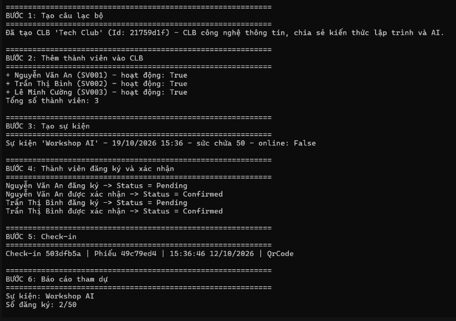

# EduHub.Ch01 – Domain Modeling

Hệ thống quản lý Câu lạc bộ & Sự kiện sinh viên (Trường Đại học Đồng Tháp) – bài tập CH01 môn IN4211.

## Thiết kế domain
- **Member**: thành viên sinh viên; có `IsActive()`.
- **Club**: CLB, quản lý danh sách `Members` (`AddMember`, `MemberCount`).
- **Event**: sự kiện của một CLB (`ClubId`), kiểm tra chỗ bằng `HasCapacity`.
- **Registration**: bảng nối Member ↔ Event, trạng thái `Pending → Confirmed / Cancelled` (enum `RegistrationStatus`).
- **CheckIn**: điểm danh gắn với 1 Registration đã xác nhận, hình thức là enum `CheckInMethod`.

Nguyên tắc: private setter, constructor private, factory `Create(...)` có validate, không dùng magic string.
Chi tiết xem `docs/user-stories.md` và `docs/class-diagram.md`.

## Cách chạy
```bash
dotnet run
```
Yêu cầu: .NET 10 SDK.

## Ảnh chụp kết quả
Kết quả chạy `dotnet run` (phần đầu và phần cuối):




