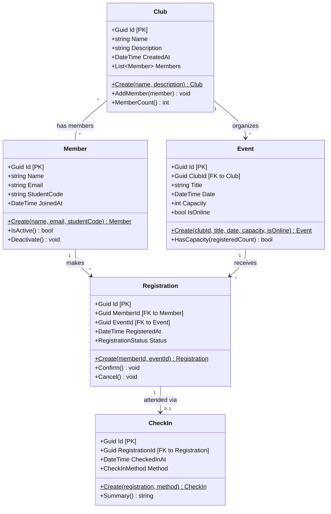

# Class Diagram – EduHub (sơ bộ)

**Chú thích:** `Id` là khoá chính (PK); các thuộc tính `ClubId`, `MemberId`, `EventId`, `RegistrationId` là khoá ngoại (FK).
Quan hệ Member ↔ Event là nhiều–nhiều, được hiện thực qua bảng nối `Registration`.
