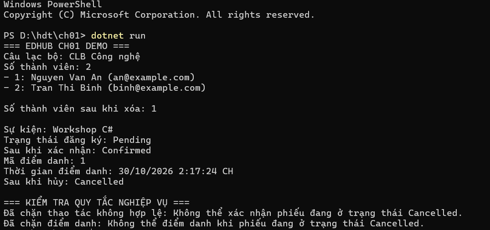

# EDUHUB CH01 - KẾT QUẢ CHẠY CHƯƠNG TRÌNH

## 1. Kết quả thực thi

Chạy chương trình bằng lệnh `dotnet run`.

## 2. Các chức năng đã kiểm tra

- Tạo câu lạc bộ và thành viên.
- Thêm và xóa thành viên.
- Tạo sự kiện.
- Đăng ký và xác nhận đăng ký.
- Hủy đăng ký.
- Điểm danh.
- Kiểm tra quy tắc nghiệp vụ.

## 3. Kết luận

Chương trình EduHub Ch01 chạy thành công.